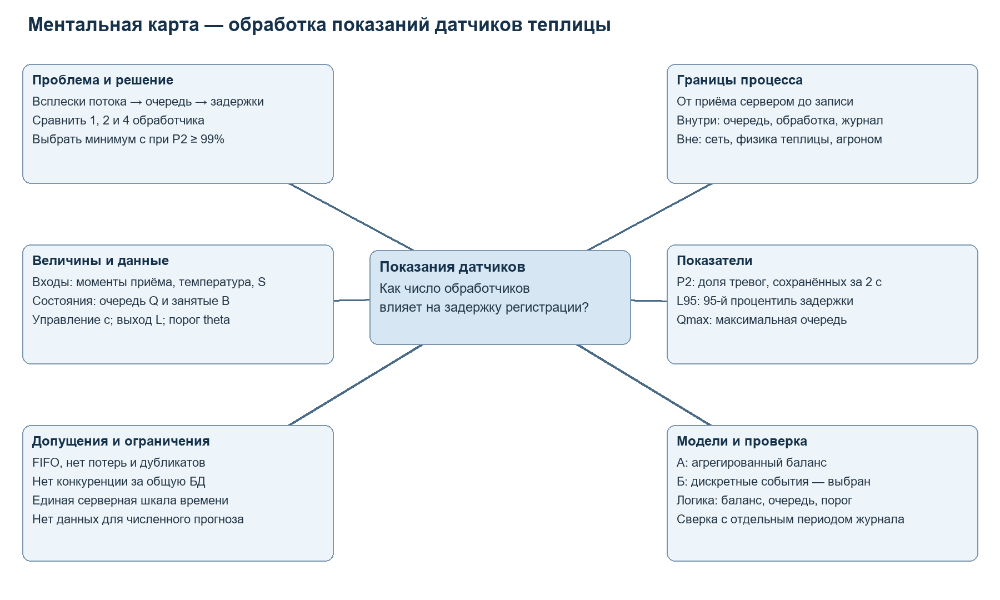
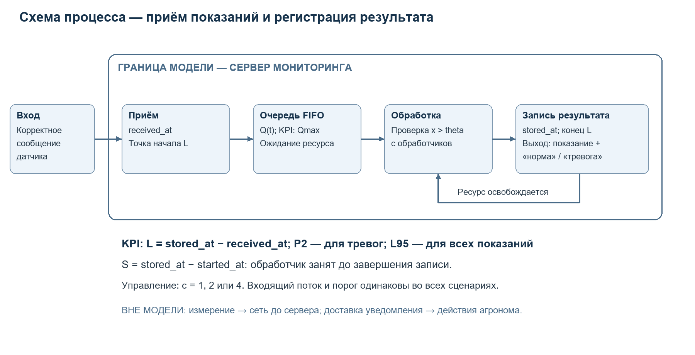

# Ходеев А. А. ДЭ 37-26

# Практическая работа 1

**Постановка задачи моделирования информационного процесса**

Дисциплина: «Модели информационных процессов и систем».

## 2. Постановка задачи

**Обработка показаний датчиков теплицы и задержки регистрации тревог**

[Краткое описание модели на двух страницах](report.pdf)

## Ментальная карта

## 3.1 Проблема и решение

Датчики температуры теплицы передают показания на сервер мониторинга. Одновременная отправка сообщений несколькими датчиками может создавать очередь перед обработчиками. Даже уже полученное сервером показание о превышении порога тогда будет обработано с задержкой. Необходимо выбрать число обработчиков, которое обеспечивает своевременную регистрацию тревог без избыточного выделения ресурсов.
Заинтересованная сторона — инженер системы мониторинга; агроном задаёт пороги тревоги. Решение: выбрать минимальное c из альтернатив 1, 2 или 4 параллельных обработчика при общей очереди FIFO. Проектный критерий: не менее 99% тревожных показаний обрабатываются за 2 секунды; это учебный ориентир для согласования, а не агрономический норматив. Если подходящего сценария нет, исследуются другие мощности или изменение алгоритма.
Главный вопрос: как изменится доля тревожных показаний, результат обработки которых сохранён не позднее 2 секунд после приёма сервером, при c = 1, 2 и 4 и одинаковом входящем потоке?
Развитие: разнесение моментов отправки датчиков, приоритетная обработка тревог и подавление повторных уведомлений.

## 3.2 Границы системы

Начало — приём корректного сообщения сервером; конец — сохранение показания и результата сравнения с порогом в журнале. Внутри: приём, FIFO-очередь, пул обработчиков, сравнение температуры с порогом и запись результата. События: поступление, начало обработки, завершение записи; состояния сообщения: ожидает, обрабатывается, сохранено. Обработчик занят до окончания записи, затем берёт следующее сообщение.
Снаружи: датчики, сеть до сервера, температура и расписание отправки. Исключены физика теплицы, ошибки измерений, некорректные пакеты, доставка уведомлений, действия агронома и исполнительных устройств. Модель не устанавливает время от реального перегрева до реакции человека и не доказывает безопасность растений.

## 3.3 Схема процесса

Вход — сообщение с идентификатором датчика, временем измерения и температурой; выход — сохранённое показание со статусом «норма» или «тревога». На схеме img/process.png обозначены граница, очередь, обработка, выход и точки измерения received_at и stored_at; разность этих меток определяет задержку L_i.

## 3.4 Словарь величин

| Обозначение | Название и единица | Роль | Источник |
|---|---|---|---|
| A_d | Поступления за интервал d, шт. | Вход | received_at |
| x_i | Температура в сообщении, °C | Вход | temperature |
| Q(t) | Ожидающие сообщения, шт. | Состояние | События приёма и старта |
| c | Обработчики, ед. | Управляемый параметр | Конфигурация сервера |
| S_i | Обслуживание, с | Вход модели | stored_at − started_at |
| L_i | Серверная задержка, с | Выход | stored_at − received_at |
| theta | Порог тревоги, °C | Фиксированный параметр | Настройки агронома |
| B(t) | Занятые обработчики, ед. | Состояние | События старта и записи |

## 3.5 Показатели результата

Для когорты N сообщений, принятых в контрольном интервале, L_i = stored_at_i − received_at_i, в секундах. После конца интервала модель дорабатывает эту когорту до сохранения всех сообщений; начальные очередь и занятость учитываются отдельно. Тревожность a_i = 1, если x_i > theta, иначе 0; theta фиксирован во всех сценариях.
1. P2 = 100% × count(a_i = 1 и L_i ≤ 2) / count(a_i = 1). Увеличивать; основной критерий выбора c, ориентир ≥ 99%. Без тревожных сообщений P2 не определён.
2. L95 = L(k), где k = 0,95N с округлением вверх, после сортировки задержек всех сообщений. Уменьшать; показывает задержки большинства показаний. При N = 0 не определён.
3. Qmax = max Q(t) за контрольный интервал, шт. Уменьшать; характеризует наибольшее накопление очереди при выбранном c. Это не размер памяти в байтах.
Одно среднее скрывает редкие задержки: условные 99 сообщений по 0,1 с и одно за 10 с дают среднее 0,199 с. При этом задержка единственного тревожного сообщения может оказаться неприемлемой.

## 3.6 Допущения и ограничения

Допущения: (1) в рассматриваемом интервале корректные сообщения не теряются и не дублируются; иначе очередь и доля своевременных тревог искажаются; (2) обслуживание FIFO, без вытеснения; при приоритетах изменится распределение задержек; (3) обработчики одинаковы, длительности обслуживания не меняются при росте c; при конкуренции за БД модель переоценит эффект распараллеливания; (4) серверные метки используют общую монотонную шкалу времени; иначе задержки могут оказаться неверными.
Ограничения: исходные журналы не предоставлены — численные результаты и лучший сценарий пока неизвестны; выводы относятся к принятому потоку и доступным ресурсам; время до приёма сервером и после записи результата не оценивается. Порог theta и критерий 2 с должны быть согласованы с владельцем процесса.

## 3.7 Два варианта модели

По степени детализации: А — агрегированная модель потока, Б — модель отдельных сообщений. Отдельно по времени: А использует фиксированные шаги, Б — события; оба варианта динамические. Случайность поступлений и обслуживания задаётся отдельно при наличии данных.
А. Балансовая модель по временным интервалам отвечает, накапливается ли очередь при средней нагрузке. Нужны числа поступлений и завершений по интервалам, c и начальное число сообщений в системе. Баланс учитывает ожидающие и обрабатываемые сообщения. Модель проста, но усредняет порядок поступлений и не позволяет восстановить P2 и L95 по одним агрегатам; пригодна для предварительной оценки нагрузки.
Б. Дискретно-событийная имитация отвечает, какие задержки возникают у отдельных показаний и тревог при разных c. Нужны моменты поступления, значения температуры, порог, длительности обслуживания и начальные состояния. Внутренние операции заменяются длительностью S_i, учитывающей запись в БД. Выбирается Б, поскольку сохраняет индивидуальные задержки. Сценарии используют одинаковый поток и длительности; при случайных входах нужны повторные прогоны и интервалы неопределённости.

## 3.8 План проверки

Данные: message_id, sensor_id, measured_at, received_at, started_at, stored_at, temperature, threshold, alarm_flag, worker_id и статус результата. Нужны конфигурация c и снимок начальных очереди и занятости. Проверяются уникальность ID, пропуски, порядок серверных меток и незавершённые записи. measured_at сохраняется для контекста, но не входит в серверную задержку L_i.
Логика реализации: при пустой системе одно сообщение без конкуренции имеет L_i = S_i. При отсутствии поступлений очередь не растёт; Q ≥ 0, занятых не больше c; начальные плюс поступившие сообщения равны ожидающим, обрабатываемым и сохранённым. Граничный тест порога: x_i = theta — норма, x_i > theta — тревога.
Согласие с наблюдениями: настроить длительности на одном периоде, затем воспроизвести другой период журнала с фактическими c и начальными состояниями. Сравнить P2, L95 и кривую Q(t), включая всплески. До проверки согласовать допуски, например 2 процентных пункта для P2 и 20% для L95 при ненулевом наблюдаемом значении; отдельно проверить достаточность числа тревог. При расхождении уточнить модель. Здесь задан план, а не выполненный эксперимент.

## Материалы и основание работы

- `report.pdf` — описание модели на двух страницах.
- `img/mindmap.png` и `img/process.png` — ментальная карта и схема.
- `diagrams/` — редактируемые исходники Mermaid.

Работа выполнена по заданию «task01-intro.docx». Структура оформления — по [предоставленному примеру](https://github.com/akayamixd/mips-tasks/tree/main/task01); тема, постановка и схемы разработаны для мониторинга теплицы. Все числовые ориентиры являются проектными, а не результатами измерений.

## 5. Взаимное рецензирование

Рецензия на работу другого студента добавляется после получения этой работы. Проверяются главный вопрос, границы системы, вычислимость KPI и связь показателей с решением.
