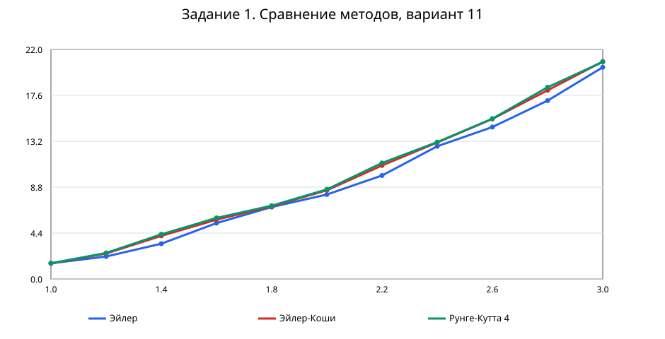
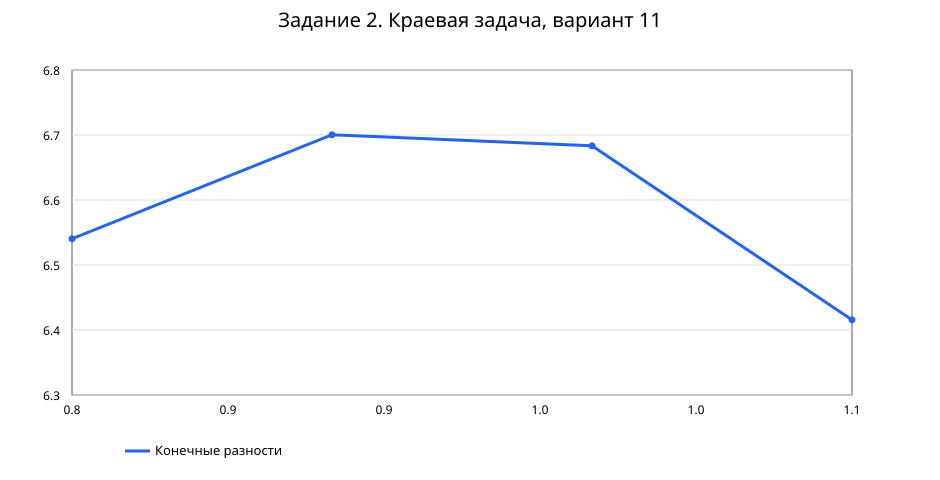

# Практическая работа № 2 — численное решение дифференциальных уравнений

**Дисциплина:** Модели информационных процессов и систем  
**Студент:** Ходеев Александр, группа ДЭ 37-26  
**Вариант:** 11

Источник: В. А. Калитвин, «Динамические модели информационных систем. 1. Численное решение дифференциальных уравнений», 29.10.2026, задания на стр. 9–12. Реализованы **оба** задания.

## Задание 1. Задача Коши

**Условие:** `y' = 5x + 3cos(y + 2,6)`, `y(1) = 1,5`, отрезок `[1;3]`, шаг `h=0,2`. Всего 10 шагов, 11 узлов.

Обозначим `f(x,y)=5x+3cos(y+2,6)`. Вычисляются три решения:

1. **Метод Эйлера:** `y[i+1]=y[i]+h*f(x[i],y[i])`. Первый шаг: `f(1;1,5)≈3,275528`; `y(1,2)≈2,155106`.
2. **Метод Эйлера-Коши:** прогноз `z=y[i]+h*f(x[i],y[i])`; коррекция `y[i+1]=y[i]+h*(f(x[i],y[i])+f(x[i+1],z))/2`.
3. **Метод Рунге-Кутты четвёртого порядка:** `k1=h*f(x,y)`, `k2=h*f(x+h/2,y+k1/2)`, `k3=h*f(x+h/2,y+k2/2)`, `k4=h*f(x+h,y+k3)`; `y_next=y+(k1+2*k2+2*k3+k4)/6`.

**Уточнение:** на странице 5 методички последний шаг RK4 напечатан без слагаемого `y[i]`. В программе используется правильная формула, учитывающая предыдущее значение.

### Результаты

| x | Эйлер | Эйлер–Коши | Рунге–Кутта 4 |
|---:|---:|---:|---:|
| 1.0 | 1.500000 | 1.500000 | 1.500000 |
| 1.2 | 2.155106 | 2.440364 | 2.496019 |
| 1.4 | 3.380728 | 4.133613 | 4.281110 |
| 1.6 | 5.353492 | 5.684391 | 5.850546 |
| 1.8 | 6.893884 | 6.965763 | 7.023843 |
| 2.0 | 8.095317 | 8.502142 | 8.586824 |
| 2.2 | 9.917857 | 10.881721 | 11.120151 |
| 2.4 | 12.717151 | 13.081695 | 13.117743 |
| 2.6 | 14.562391 | 15.342323 | 15.360753 |
| 2.8 | 17.092727 | 18.085510 | 18.376548 |
| 3.0 | 20.291786 | 20.837426 | 20.803363 |



**Вывод:** на правой границе `x=3` получены значения **20,291786**, **20,837426** и **20,803363** соответственно. Метод Эйлера самый простой, метод Рунге-Кутты четвёртого порядка обычно обеспечивает более высокую точность. Без точного решения расхождение методов нельзя считать точной оценкой ошибки.

## Задание 2. Краевая задача

**Условие:**

- `y'' - (3/x)y' + 5y = 9`, отрезок `[0,8;1,1]`, шаг `h=0,1`.
- Первое краевое условие: `y'(0,8)=1,6`.
- Второе: `2y(1,1)+3y'(1,1)=4,8`.

Решаем методом конечных разностей **по односторонней схеме из методички**, а не подменяем её центральной. Узлы `x0=0,8`, `x1=0,9`, `x2=1,0`, `x3=1,1`.

Уравнение представим как `y''+p(x)y'+q(x)y=r(x)`, где `p(x)=-3/x`, `q(x)=5`, `r(x)=9`. Используем следующие аппроксимации:

```text
y'(x_i)  ≈ (y[i+1] - y[i]) / h
y''(x_i) ≈ (y[i+2] - 2*y[i+1] + y[i]) / h²
(1-h*p_i+h²*q_i)*y[i] + (h*p_i-2)*y[i+1] + y[i+2] = h²*r_i
```

### Полученная СЛАУ

```text
 1,42500000*y0 - 2,37500000*y1 + y2                  = 0,09
                + 1,38333333*y1 - 2,33333333*y2 + y3 = 0,09
-y0 + y1                                              = 0,16
                                  -3*y2 + 3,2*y3      = 0,48
```

Второе уравнение в программе использует коэффициенты полной точности: `1 + 0,3/0,9 + 0,05` и `-2 - 0,3/0,9`. Систему решаем методом Гаусса с выбором главного элемента.

| Узел | x | y(x) |
|---:|---:|---:|
| 0 | 0.8 | 6.540364 |
| 1 | 0.9 | 6.700364 |
| 2 | 1.0 | 6.683345 |
| 3 | 1.1 | 6.415636 |



**Проверка:**
- `(y1-y0)/0,1 = 1,6`;
- `2*y3 + 3*(y3-y2)/0,1 = 4,8`;
- максимальная невязка СЛАУ `≈1,67 × 10⁻¹⁵`.

**Вывод:** краевые условия и составленная система выполняются с точностью машинных вычислений. Невязка матрицы показывает правильность решения дискретной системы, но не является мерой ошибки относительно точного решения исходной задачи.

## Итог

По варианту 11 численно решена задача Коши **тремя методами** и краевая задача **методом конечных разностей**. Получены таблицы узлов, графики, программы и автоматические тесты.

## Как запустить

Требуется Python 3.10+:

```bash
python -m pip install -r task2/requirements.txt
python task2/solution.py
python -m unittest discover -s task2 -p 'test_*.py' -v
```

Без matplotlib вычисления и CSV тоже работают, но PNG-графики не создаются. В репозитории уже лежат SVG-графики, которые GitHub открывает сразу.

## Файлы

- `solution.py` — три метода задачи Коши, разностная схема, Гаусс, экспорт CSV и PNG.
- `test_solution.py` — проверка начального и граничных условий и структуры матрицы.
- `results/task1.csv` — значения трёх методов на 11 узлах.
- `results/task2.csv` — решение краевой задачи на 4 узлах.
- `results/plot_task1.svg`, `results/plot_task2.svg` — графики для просмотра в GitHub.
- `results/summary.txt` — итоговые результаты.
